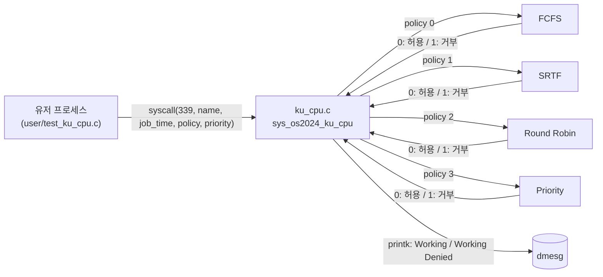

# Linux Kernel CPU Scheduler
 
Linux 커널(4.20.11)에 **사용자 정의 시스템 콜**을 추가하고, 그 안에서 4가지 CPU 스케줄링 정책(FCFS, SRTF, Round Robin, Priority with Preemption)을 구현한 운영체제 실습 프로젝트입니다.
 
여러 유저 프로세스가 0.1초마다 시스템 콜로 "CPU를 써도 되는지" 요청하고, 커널 안의 스케줄러가 정책에 따라 **허용(Working)** 또는 **거부(Working Denied)** 를 응답합니다. 각 프로세스는 종료 시 자신의 응답 시간과 총 대기 시간을 출력합니다.
 
## 개발 환경
 
| 항목 | 버전 |
|---|---|
| 가상화 | VirtualBox 7.0.20 |
| OS | Ubuntu 18.04.2 LTS |
| 커널 | Linux Kernel Source 4.20.11 |
| 언어 | C |
 
## 구현한 스케줄링 정책
 
| 번호 | 정책 | 파일 | 판단 기준 |
|:---:|---|---|---|
| 0 | FCFS (First-Come, First-Served) | `fcfs.c` | 먼저 요청한 프로세스가 끝날 때까지 실행, 나머지는 큐에서 대기 (PID 기준) |
| 1 | SRTF (Shortest Remaining Time First) | `srtf.c` | 남은 실행 시간이 가장 짧은 프로세스를 선점 실행 |
| 2 | Round Robin | `rr.c` | Time Quantum(10 tick = 1초)마다 큐 앞의 프로세스를 교대 |
| 3 | Priority with Preemption | `pp.c` | 우선순위 값이 **작을수록** 높은 우선순위, 더 높은 우선순위가 오면 선점 |
 
## 동작 구조
 

 
1. 유저 프로세스는 `job_time`(초)을 0.1초 단위 tick으로 바꾼 뒤, 0.1초마다 시스템 콜을 호출합니다.
2. 반환값이 `0`이면 CPU를 사용한 것으로 보고 `job_time`을 1 줄이고, `1`이면 대기 시간을 1 늘립니다.
3. 커널은 결과를 `printk`로 남기며, `dmesg`에서 스케줄링 과정을 확인할 수 있습니다.
### 추가한 시스템 콜
 
| 번호 | 이름 | 설명 |
|:---:|---|---|
| 338 | `os2024_pid_print(char *name)` | 테스트용 시스템 콜 |
| 339 | `os2024_ku_cpu(char *name, int job_time, int policy, int priority)` | 스케줄링 요청 시스템 콜 |
 
| 반환값 | 의미 |
|:---:|---|
| `0` | CPU 사용 허용 (Working) |
| `1` | CPU 사용 거부, 대기 (Working Denied) |
| `-EINVAL` | 알 수 없는 정책 번호 |
 
## 폴더 구조
 
```
linux-kernel-cpu-scheduler/
├── linux-4.20.11/                  # 커널 소스 트리와 동일한 경로 (그대로 덮어쓰기)
│   ├── arch/x86/entry/syscalls/
│   │   └── syscall_64.tbl          # 338, 339번 시스템 콜 등록
│   ├── include/linux/
│   │   └── syscalls.h              # 시스템 콜 프로토타입 선언
│   └── kernel/sched/
│       ├── Makefile                # 스케줄러 오브젝트 빌드 추가
│       ├── ku_cpu.c                # 시스템 콜 진입점 + 정책 분기
│       ├── ku_queue.c / .h         # FCFS용 원형 큐
│       ├── fcfs.c / .h
│       ├── srtf.c / .h
│       ├── rr.c / .h
│       └── pp.c / .h
├── user/
│   ├── test_ku_cpu.c               # 시스템 콜을 호출하는 테스트 프로세스
│   └── Makefile
├── scripts/
│   ├── run.sh                      # 프로세스 A, B, C 실행 (FCFS / SRTF / RR)
│   └── run_priority.sh             # 우선순위를 포함해 실행 (Priority)
└── docs/
    └── report.pdf                  # 구현 및 실험 결과 보고서
```
 
## 빌드 및 설치
 
### 1. 커널 소스에 파일 적용
 
`linux-4.20.11/` 폴더는 커널 소스 트리와 경로가 같으므로 그대로 덮어쓰면 됩니다.
 
```bash
# 커널 소스가 ~/linux-4.20.11 에 있다고 가정
cp -r linux-4.20.11/* ~/linux-4.20.11/
```
 
### 2. 커널 빌드 및 설치
 
```bash
cd ~/linux-4.20.11
make -j$(nproc)
sudo make modules_install
sudo make install
sudo reboot
```
 
재부팅 후 `uname -r`로 새 커널로 부팅되었는지 확인합니다.
 
### 3. 테스트 프로그램 빌드
 
```bash
cd user
make            # gcc -o p test_ku_cpu.c
```
 
## 실행 방법
 
### 정책 선택
 
현재 테스트 프로그램은 정책이 코드에 고정되어 있습니다. `user/test_ku_cpu.c`에서 아래 값을 원하는 정책으로 바꾼 뒤 다시 빌드하세요.
 
```c
int policy = RR_POLICY;   // FCFS_POLICY, SRTF_POLICY, RR_POLICY, PP_POLICY
```
 
### 테스트 프로세스 인자
 
```bash
./p <job_time(초)> <delay(초)> <name> [priority]
```
 
| 인자 | 설명 |
|---|---|
| `job_time` | CPU를 사용할 총 시간(초) |
| `delay` | 시작 전 대기 시간(초), 즉 도착 시간 |
| `name` | 프로세스 이름 |
| `priority` | (선택) 우선순위, 작을수록 높음. Priority 정책에서 사용 |
 
### 실험 시나리오
 
```bash
# FCFS / SRTF / Round Robin
./scripts/run.sh
#   A: 7초, 0초에 도착
#   B: 5초, 1초에 도착
#   C: 3초, 2초에 도착
 
# Priority with Preemption
./scripts/run_priority.sh
#   A: 7초, 0초에 도착, 우선순위 2
#   B: 5초, 1초에 도착, 우선순위 1
#   C: 3초, 2초에 도착, 우선순위 3
```
 
커널 쪽 스케줄링 로그는 다른 터미널에서 확인합니다.
 
```bash
dmesg -w
```
 
## 실행 결과
 
위 시나리오의 정책별 실행 순서입니다.
 
| 정책 | 실행 순서 |
|---|---|
| FCFS | A(7s) → B(5s) → C(3s) |
| SRTF | A(1s) → B(1s) → C(3s) → B(4s) → A(6s) |
| Round Robin | A(1s) → B(1s) → A(1s) → C(1s) → B(1s) → … 순으로 1초씩 교대 |
| Priority | A(1s) → B(5s) → A(6s) → C(3s) |
 
### 정책별 특징 정리
 
- **FCFS**: 구현이 가장 단순하지만, 긴 작업(A)이 먼저 오면 뒤의 프로세스 대기 시간이 길어집니다(Convoy effect). 순서가 중요한 환경에 적합합니다.
- **SRTF**: 평균 대기·응답 시간이 가장 짧고 고르게 나타났습니다. 다만 긴 작업이 계속 밀리는 기아(Starvation) 위험이 있습니다.
- **Round Robin**: 모든 프로세스가 CPU를 공평하게 나눠 써서 응답이 고르게 나옵니다. Time Quantum 설정에 따라 성능 차이가 큽니다.
- **Priority with Preemption**: 중요한 작업을 먼저 처리할 수 있지만, 우선순위가 낮은 프로세스(C)는 오래 기다리게 됩니다.
정책별 응답 시간·대기 시간 그래프와 커널 로그 캡처는 [`docs/report.pdf`](docs/report.pdf)에 있습니다.
 
## 구현 메모
 
- FCFS는 PID로, SRTF·Round Robin·Priority는 **프로세스 이름(name)** 으로 프로세스를 구분합니다. 같은 이름으로 여러 프로세스를 띄우면 하나로 취급됩니다.
- Round Robin과 Priority는 최대 3개 프로세스를 기준으로 구현되어 있습니다 (`MAX_PROC`, `MAX_TASKS`).
- FCFS는 `spinlock`으로 임계 구역을 보호합니다.
- SRTF는 커널 연결 리스트(`list_head`)와 `kmalloc`으로 PCB를 관리합니다.
